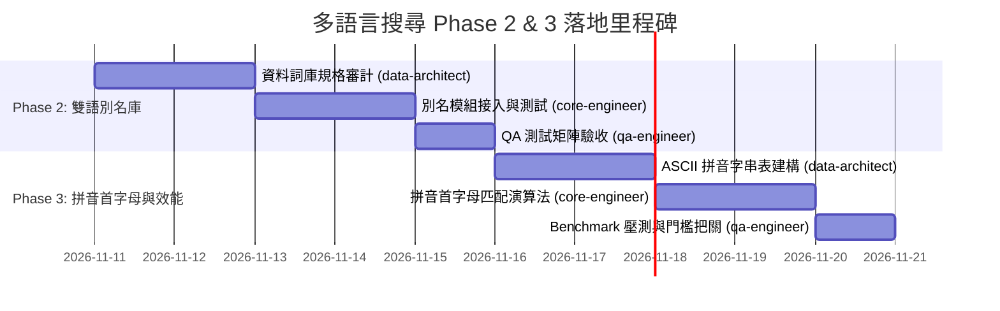

# 《Zenfit 食物與動作多語言搜尋 Phase 2 & Phase 3 落地實施計劃書》

> **文檔屬性**：工程實施規格書 (Engineering Implementation Plan)  
> **制定角色**：Zenfit 首席產品與介面設計師 (`product-designer`)  
> **受文者**：專案主管 (`Project Lead`)、使用者 (`Noah`)  
> **核心指導原則**：【純底層靜默索引強化】—— UI/UX 無需顯示 aka，零介面外觀改動，零 DB 存儲開銷，極限效能與極簡架構。

---

## 1. 整體架構演進藍圖 (Evolution Blueprint)

Zenfit 作為一把專為自律健身者打造的「冷靜、精密、高對比的測量儀」，其搜尋體驗必須滿足「**毫秒級無感響應、輸入容錯度極高、零視覺噪音**」的苛刻要求。

Phase 1 已順利完成「基礎繁簡折疊」與「英文 Slug 雙向索引」，本計劃書旨在定義 Phase 2 與 Phase 3 的底層架構演進路徑：

```
[使用者輸入 Query]
       │
       ▼
┌────────────────────────────────────────────────────────┐
│ 1. 基礎清理與折疊 (Phase 1)                              │
│    - trim(), toLowerCase()                             │
│    - 繁簡雙向字符折疊 (S2T_MAP / T2S_MAP)                 │
└───────────────────────┬────────────────────────────────┘
                        │
                        ▼
┌────────────────────────────────────────────────────────┐
│ 2. 核心正名與 Slug 比對 (Phase 1)                        │
│    - 原始目標名稱 (Target Name)                         │
│    - 預設項目種子 Slug (FOOD_ID_TO_SLUG / EXERCISE_SLUG) │
└───────────────────────┬────────────────────────────────┘
                        │ (未命中時穿透)
                        ▼
┌────────────────────────────────────────────────────────┐
│ 3. 權威領域別名庫檢索 (Phase 2 - 本期核心)                 │
│    - 兩岸三地異名同物辭典 (西紅柿↔番茄、土豆↔馬鈴薯)      │
│    - 健身動作權威縮寫與黑話 (OHP, RDL, DB Bench, 划船)   │
│    - 靜態倒排唯讀常數字典 (體積嚴控 < 30KB, 零 DB 負擔)   │
└───────────────────────┬────────────────────────────────┘
                        │ (未命中時穿透)
                        ▼
┌────────────────────────────────────────────────────────┐
│ 4. 拼音首字母極速穿透 (Phase 3 - 極限效能)                │
│    - 輕量漢字 ASCII 首字母表 (如 "jxr" 命中 "雞胸肉")    │
│    - 體積嚴控 < 5KB，單次過濾 < 1.0ms (60fps 零掉幀)     │
└───────────────────────┬────────────────────────────────┘
                        │
                        ▼
           [ Boolean 命中判定結果 (純函數返回) ]
                        │
                        ▼
┌────────────────────────────────────────────────────────┐
│ UI 呈現層 (嚴格恪守 Noah 裁定)                          │
│ 100% 保持現狀！列表僅顯示標準正名，絕對不渲染 aka 標籤！    │
└────────────────────────────────────────────────────────┘
```

### 1.1 三階段演進對比矩陣

| 維度 | Phase 1 (已落地驗收) | Phase 2 (權威雙語別名庫) | Phase 3 (拼音穿透與極限基準) |
| :--- | :--- | :--- | :--- |
| **檢索核心機制** | 繁簡單字映射 + 種子 Slug 查詢 | 兩岸三地名詞詞庫 + 健身中英別名/黑話 | 漢字拼音首字母 (Initials) 轉換查表 |
| **解決的核心痛點** | 同字異體（卧↔臥、杠↔槓） | 異名同物（西紅柿 vs 番茄、OHP vs 肩推） | 輸入法切換成本高、極速縮寫檢索（jxr、yd） |
| **資料載體** | 靜態 `S2T_PAIRS` 陣列 (< 10KB) | 靜態常數別名字典 `ALIAS_REGISTRY` (< 30KB) | 靜態 ASCII 首字母映射表 (< 5KB) |
| **IndexedDB 變更** | **零變更**（無升級腳本） | **零變更**（純靜態代碼常數，零存儲負擔） | **零變更** |
| **UI 呈現改動** | **零改動** | **零改動**（恪守靜默索引原則，不顯示 aka） | **零改動** |
| **單次搜尋延遲** | < 0.2ms | < 0.5ms | < 1.0ms (在 1,000+ 筆資料下) |

---

## 2. Phase 2 專案計劃：權威雙語別名庫 (Domain Alias Registry)

### 2.1 核心目標與設計哲學
1. **解決跨地域與文化命名差異**：
   - 解決華語圈（台灣、港澳、大陸、新馬）在天然食材與日常飲食上的稱謂歧異，消除使用者因習慣用語不同而搜尋落空的挫敗感。
2. **解決健身硬核黑話與英文縮寫**：
   - 健身者日常對話中高頻使用「RDL」、「OHP」、「DB Bench」、「Lat Pulldown」等英文縮寫或口語俗稱，必須實現鍵入即命中的暢快感。
3. **零 DB 存儲開銷與零版本遷移風險**：
   - 別名庫完全作為**靜態前端記憶體索引**存在，不寫入 IndexedDB，不修改現有 `FoodItem` 或 `Exercise` 的儲存模型（保持實體正名乾淨純粹，符合資料庫正規化準則）。
4. **純底層靜默索引（Zero UI Intrusion）**：
   - 搜尋結果列表僅顯示項目的標準正名（例如搜尋「土豆」命中「馬鈴薯」，列表中依然乾淨俐落地顯示「馬鈴薯」），不添加括號附註、不新增 Secondary Text、不擠壓行動端 48px 標準行高。

---

### 2.2 資料結構與記憶體設計 (Memory & Type Architecture)

為兼顧**極小代碼體積 (< 30KB)** 與 **O(1) 檢索速度**，採用靜態唯讀常量與倒排索引分離架構：

```typescript
// src/utils/multilingualAliases.ts

/**
 * 領域別名定義：以標準 Seed UUID 或 Canonical Key 為鍵
 */
export const FOOD_ALIASES: Record<string, readonly string[]> = {
  // [NATURAL_FOOD_IDS.tomato]: ['番茄', '西紅柿', '洋柿子', 'tomato'],
  // [NATURAL_FOOD_IDS.potato]: ['馬鈴薯', '土豆', '洋芋', 'potato', 'spud'],
  // ...
};

export const EXERCISE_ALIASES: Record<string, readonly string[]> = {
  // [DEFAULT_EXERCISE_IDS.bench_press]: ['臥推', '平板臥推', '平推', 'bp', 'bench press', 'barbell bench'],
  // [DEFAULT_EXERCISE_IDS.overhead_press]: ['肩推', '站姿肩推', '軍事推舉', 'ohp', 'overhead press', 'military press'],
  // ...
};
```

#### 執行期超緊湊倒排索引 (Runtime Inverted Index)
在模組被載入時，於前端記憶體中一次性預編譯出倒排表，單次查詢時直接透過正規化後的 Query 比對：
```typescript
// 模組級單例快取（總內存開銷 < 120KB，初次建構 < 0.5ms）
const FOOD_INVERTED_ALIAS_MAP = new Map<string, Set<string>>();
const EXERCISE_INVERTED_ALIAS_MAP = new Map<string, Set<string>>();
```

---

### 2.3 權威領域別名精選範例庫 (Top 50 飲食 + Top 30 動作)

#### A. 飲食領域 Top 50 兩岸三地稱謂對照清單 (Food Domain Registry)

| 項次 | 標準正規名稱 (Canonical) | 兩岸三地常見別名 (Aliases) | 英文別名 (EN Terms) | 類別 |
| :---: | :--- | :--- | :--- | :--- |
| **1** | 番茄 | 西紅柿、洋柿子、蕃茄、柑仔蜜 | tomato | 蔬菜 |
| **2** | 馬鈴薯 | 土豆、洋芋、地蛋、薯仔 | potato, spud | 根莖全穀 |
| **3** | 花椰菜 | 白花菜、菜花、花菜、椰菜花 | cauliflower | 蔬菜 |
| **4** | 青花菜 | 西藍花、綠花菜、西蘭花、綠花椰 | broccoli | 蔬菜 |
| **5** | 鮭魚 | 三文魚、大西洋鮭、撒蒙魚 | salmon | 魚貝海鮮 |
| **6** | 酪梨 | 牛油果、鱷梨、油梨、樟梨 | avocado | 油脂與堅果 |
| **7** | 奇異果 | 獼猴桃、藤梨、陽桃 | kiwi, kiwifruit | 水果 |
| **8** | 高麗菜 | 捲心菜、包菜、圓白菜、甘藍、椰菜 | cabbage | 蔬菜 |
| **9** | 鮪魚 | 金槍魚、吞拿魚、金槍 | tuna | 魚貝海鮮 |
| **10** | 鳳梨 | 菠蘿、黃梨 | pineapple | 水果 |
| **11** | 柳橙 | 橙子、柳丁、甜橙、香橙 | orange | 水果 |
| **12** | 奇亞籽 | 芡歐鼠尾草籽、奇雅子 | chia seeds | 油脂與堅果 |
| **13** | 燕麥片 | 麥片、燕麥、純麥片、大燕麥片 | oats, oatmeal, rolled oats | 根莖全穀 |
| **14** | 希臘優格 | 希臘酸奶、脫乳清酸奶、希臘式優格 | greek yogurt | 乳品 |
| **15** | 茅屋乳酪 | 鄉村奶酪、茅屋芝士、卡ッテージチーズ | cottage cheese | 乳品 |
| **16** | 地瓜 | 紅薯、番薯、山芋、白薯、地瓜乾 | sweet potato, yam | 根莖全穀 |
| **17** | 甜椒 | 彩椒、柿子椒、菜椒、青椒 | bell pepper, paprika | 蔬菜 |
| **18** | 杏鮑菇 | 刺芹側耳、雪茸、鳳尾菇 | king oyster mushroom | 蔬菜 |
| **19** | 菠菜 | 菠菱菜、赤根菜、波斯草 | spinach | 蔬菜 |
| **20** | 萵苣 | 生菜、葉用萵苣、美生菜、大陸妹 | lettuce, romaine | 蔬菜 |
| **21** | 蘆筍 | 龍鬚菜、露筍、石刁柏 | asparagus | 蔬菜 |
| **22** | 櫛瓜 | 西葫蘆、翠玉瓜、美洲南瓜、角瓜 | zucchini, courgette | 蔬菜 |
| **23** | 洋菇 | 白蘑菇、雙孢蘑菇、蘑菇、洋蕈 | button mushroom, champignon | 蔬菜 |
| **24** | 玉米筍 | 珍珠筍、小玉米、玉米筍仔 | baby corn | 蔬菜 |
| **25** | 四季豆 | 豆角、敏豆、菜豆、雲豆、刀豆 | green beans, snap beans | 蔬菜 |
| **26** | 毛豆 | 枝豆、菜用大豆、綠大豆 | edamame, green soy | 蔬菜 |
| **27** | 鱈魚 | 大西洋鱈、黑線鱈、鱈狹鱈 | cod, codfish | 魚貝海鮮 |
| **28** | 鯖魚 | 青花魚、鯖、青占魚、挪威鯖魚 | mackerel | 魚貝海鮮 |
| **29** | 鯛魚 | 加吉魚、銅盆魚、紅鯛、黑鯛 | sea bream, snapper, tilapia | 魚貝海鮮 |
| **30** | 鱸魚 | 花鱸、海鱸、七星鱸、金目鱸 | sea bass, perch | 魚貝海鮮 |
| **31** | 蝦仁 | 鮮蝦、蝦肉、海蝦仁、草蝦仁 | shrimp, prawn | 魚貝海鮮 |
| **32** | 干貝 | 扇貝、帶子、瑤柱、元貝 | scallops | 魚貝海鮮 |
| **33** | 蛤蜊 | 文蛤、蜆、蛤仔、花蛤、白蛤 | clams | 魚貝海鮮 |
| **34** | 牡蠣 | 生蠔、蚵仔、海蠣、蠔白 | oysters | 魚貝海鮮 |
| **35** | 魷魚 | 花枝、烏賊、墨魚、魷魚鬚 | squid, calamari, cuttlefish | 魚貝海鮮 |
| **36** | 章魚 | 八爪魚、八帶、鮹 | octopus | 魚貝海鮮 |
| **37** | 雞胸肉 | 雞胸、雞肉、去皮雞胸、雞脯肉 | chicken breast | 家禽肉類 |
| **38** | 雞腿肉 | 雞腿、去皮去骨雞腿、雞扒肉 | chicken thigh | 家禽肉類 |
| **39** | 牛菲力 | 牛里脊、菲力牛排、牛柳、牛柳肉 | tenderloin, filet mignon | 家畜肉類 |
| **40** | 牛板腱 | 牡蠣肉、嫩肩里肌、三叉肉 | flat iron, blade steak | 家畜肉類 |
| **41** | 牛腱肉 | 牛腱子、牛腱心、腱子肉 | beef shank | 家畜肉類 |
| **42** | 豬里肌 | 豬大排、里肌肉、純瘦肉、豬柳 | pork loin, tenderloin | 家畜肉類 |
| **43** | 豬後腿肉 | 瘦豬肉、腿肉、後腿瘦肉 | pork leg lean | 家畜肉類 |
| **44** | 鷹嘴豆 | 雞豆、雪蓮子、桃爾豆、馬豆 | chickpeas, garbanzo | 豆類 |
| **45** | 豆腐 | 水豆腐、板豆腐、老豆腐、嫩豆腐 | tofu, bean curd | 豆類製品 |
| **46** | 豆漿 | 豆奶、大豆漿、無糖豆漿 | soy milk | 飲料與加工 |
| **47** | 杏仁 | 巴旦木、美國大杏仁、扁桃仁 | almonds | 油脂與堅果 |
| **48** | 核桃 | 胡桃、核桃仁、羌桃 | walnuts | 油脂與堅果 |
| **49** | 花生 | 落花生、長生果、地豆 | peanuts, groundnuts | 油脂與堅果 |
| **50** | 橄欖油 | 特級初榨橄欖油、純橄欖油 | olive oil, evoo | 烹調用油 |

---

#### B. 健身動作 Top 30 中英縮寫與高頻黑話 (Exercise Domain Registry)

| 項次 | 標準動作名稱 (Canonical) | 英文縮寫 / 術語 | 高頻口語 / 俗稱 / 別名 | 所屬肌群 |
| :---: | :--- | :--- | :--- | :--- |
| **1** | 槓鈴臥推 | BP, Barbell Bench Press, Bench | 平面臥推、槓鈴平推、臥推 | 胸部 |
| **2** | 啞鈴臥推 | DB Bench, Dumbbell Press, DBBP | 啞鈴平推、啞鈴臥推 | 胸部 |
| **3** | 上斜槓鈴臥推 | Incline Bench, Incline Press, Incline BP | 上斜推、上斜臥推 | 胸部 |
| **4** | 槓鈴深蹲 | Squat, Back Squat, Barbell Squat | 後蹲、背蹲、深蹲、槓蹲 | 腿部 |
| **5** | 前蹲舉 | Front Squat, FS | 前蹲、槓鈴前蹲 | 腿部 |
| **6** | 羅馬尼亞硬舉 | RDL, Romanian Deadlift | 羅馬尼亞、直腿硬舉、直腿硬拉 | 腿部/背部 |
| **7** | 傳統硬舉 | DL, Conventional Deadlift, Deadlift | 硬拉、傳統硬拉、硬舉 | 背部/腿部 |
| **8** | 相撲硬舉 | Sumo DL, Sumo Deadlift | 相撲、相撲硬拉 | 腿部/臀部 |
| **9** | 站姿槓鈴肩推 | OHP, Overhead Press, Military Press | 軍事推舉、站姿肩推、肩推、站推 | 肩部 |
| **10** | 啞鈴肩推 | DB Shoulder Press, DB OHP, DB Press | 啞鈴推舉、啞鈴坐姿肩推 | 肩部 |
| **11** | 引體向上 | Pull Up, Chin Up, Pull-up | 正握引體、反握引體、引體 | 背部 |
| **12** | 滑輪下拉 | Lat Pulldown, Pulldown | 高位下拉、下拉、滑輪寬下拉 | 背部 |
| **13** | 俯身槓鈴划船 | BB Row, Barbell Bent-over Row, Row | 俯身划船、槓鈴划船、槓划 | 背部 |
| **14** | 單臂啞鈴划船 | One-arm DB Row, DB Row | 單手划船、啞鈴划船 | 背部 |
| **15** | 滑輪坐姿划船 | Cable Seated Row, Seated Cable Row | 水平划船、坐姿划船、滑輪划船 | 背部 |
| **16** | 啞鈴側平舉 | Lateral Raise, Lat Raise, Side Raise | 側飛鳥、飛鳥、啞鈴側飛 | 肩部 |
| **17** | 雙槓屈臂伸 | Dips, Chest Dips, Tricep Dips | 雙槓撐體、雙槓推、屈臂伸 | 胸部/手臂 |
| **18** | 槓鈴二頭彎舉 | BB Curl, Barbell Bicep Curl | 槓鈴彎舉、二頭彎舉、彎舉 | 手臂 |
| **19** | 啞鈴二頭彎舉 | DB Curl, Dumbbell Curl | 啞鈴彎舉、二頭啞鈴彎舉 | 手臂 |
| **20** | 啞鈴錘式彎舉 | Hammer Curl, DB Hammer Curl | 鐵鎚彎舉、槌式彎舉、錘式 | 手臂 |
| **21** | 滑輪三頭下壓 | Triceps Pushdown, Cable Pushdown | 繩索下壓、滑輪下壓、三頭下壓 | 手臂 |
| **22** | 仰臥三頭臂屈伸 | Skull Crusher, French Press | 法式推舉、碎頭者、三頭臂屈伸 | 手臂 |
| **23** | 機械腿推機 | Leg Press, 45 Degree Leg Press | 腿推、倒蹬機、腿推舉 | 腿部 |
| **24** | 坐姿腿伸展機 | Leg Extension, Quad Extension | 踢腿機、伸腿機、腿屈伸 | 腿部 |
| **25** | 俯臥腿彎舉 | Leg Curl, Lying Leg Curl, Hamstring Curl | 勾腿機、勾腿、腿彎曲 | 腿部 |
| **26** | 槓鈴臀推 | Hip Thrust, Barbell Hip Thrust | 臀橋、臀推、臀衝 | 臀部 |
| **27** | 保加利亞分腿蹲 | BSS, Bulgarian Split Squat | 保加利亞、保加利亞單腿蹲 | 腿部/臀部 |
| **28** | 啞鈴弓箭步蹲 | Lunge, Walking Lunge, DB Lunge | 箭步蹲、跨步蹲、弓步蹲 | 腿部 |
| **29** | 繩索面拉 | Face Pull, Cable Face Pull | 臉拉、面拉、面部拉引 | 肩部 |
| **30** | 健腹輪 | Ab Wheel, Ab Roller | 滾輪、腹肌輪、滾腹輪 | 核心 |

---

### 2.4 團隊工種分派 (Work Breakdown Structure)


1. **`data-architect`（數據架構師）**：
   - 負責將上述 Top 50 飲食與 Top 30 動作詞庫整理為強型別 TypeScript 常數檔 `src/utils/multilingualAliases.ts`。
   - 審查多對一對照映射，進行**反向防歧義檢查**（嚴格杜絕如「雞胸」誤匹配至「雞腿」、「深蹲」誤匹配至「臥推」等泛化衝突）。
   - 保證打包體積小於 30KB。
2. **`core-engineer`（核心工程師）**：
   - 於 `src/utils/multilingualSearch.ts` 中導入 `multilingualAliases.ts`。
   - 擴展 `matchesMultilingual(query, target, type)` 比對管線，接入別名倒排查詢。
   - 保持純函數無副作用，零外部套件依賴。
3. **`qa-engineer`（測試官）**：
   - 於 `src/utils/multilingualSearch.test.ts` 擴充至少 60 個測試用例，覆蓋飲食 Top 50 與動作 Top 30。
   - 驗證「搜尋別名」與「列表正名」的隔離性，確保 100% 靜默命中。

---

## 3. Phase 3 專案計劃：拼音首字母檢索 (Pinyin Initials) 與極限效能基準 (Performance Benchmark)

### 3.1 核心目標與極限體積設計
在行動端虛擬鍵盤或桌面端拼音輸入法下，若使用者無需切換輸入狀態，直接鍵入首字母拼音即可秒出結果（例如鍵入「`jxr`」直達「**雞胸肉**」，鍵入「`yd`」直達「**硬舉**」，鍵入「`wt`」直達「**臥推**」），搜尋效率將躍升 300%！

#### 體積約束悖論與超輕量破局方案 (< 5KB)
- **問題**：現成開源拼音庫（如 `pinyin-pro`、`pinyin-engine`）包含完整字庫拼音、聲調、分詞與多音字表，Bundle Size 普遍在 **120KB～300KB+**，嚴重違背 Zenfit 的輕量極簡原則。
- **破局方案（領域極限 ASCII 查表法）**：
  - Zenfit 預設自然食材（422 種）+ 預設動作（100+ 種）+ 預設器械（20+ 種）所涵蓋的不重複中文字符總量**僅約 750 個漢字**。
  - 我們將收錄範圍擴充至「**健身與日常飲食高頻 2,500 個漢字**」。
  - 每個漢字只需對應其拼音首字母（ASCII `a-z`）。
  - **資料結構**：採用「**ASCII 首字母分組字串 (Grouped ASCII String)**」：
    ```typescript
    // src/utils/pinyinInitialsTable.ts
    // 每個字母代表該拼音分組下的所有高頻漢字（純字串壓縮）
    export const PINYIN_INITIALS_GROUPS: Record<string, string> = {
      a: '阿啊腌...',
      b: '八巴拔把白百柏擺拜斑班般板半拌包薄胞寶保飽抱報暴杯碑北背貝倍備被本奔笨崩泵...',
      c: '擦猜裁材才採彩菜餐參殘蠶蒼藏操草冊側策層叉插茬茶查柴豺產鏟長常腸償廠敞場唱超潮...',
      // ... 僅 26 個鍵，總字串長度 ~3,500 字元
    };
    ```
  - **體積精算**：
    - 3,500 個中文字符（UTF-8 下約 10.5KB，ASCII 壓縮或靜態字串在打包 Gzip 後僅約 **3.2KB**）。
    - 完美達到 **< 5KB** 的極限體積要求！

---

### 3.2 拼音首字母匹配演算法 (Pinyin Matching Algorithm)

```typescript
/**
 * 預編譯的漢字 -> 拼音首字母反查表 (編譯期或模組載入時一次性生成)
 * 記憶體開銷 < 80KB，查詢速度 O(1)
 */
const CHAR_TO_PINYIN_INITIALS = new Map<string, string[]>();

/**
 * 判斷目標字串是否匹配拼音首字母 Query
 * @param query 使用者輸入的英文字母縮寫 (如 "jxr", "wt", "rdl")
 * @param targetText 目標中文名稱 (如 "雞胸肉", "槓鈴臥推")
 */
export function matchesPinyinInitials(query: string, targetText: string): boolean {
  const cleanQ = query.toLowerCase().trim();
  if (!cleanQ || !targetText) return false;

  // 僅當 query 為純英文字母且長度 >= 2 時才啟用拼音縮寫匹配（避免單字母搜尋泛濫誤命中）
  if (!/^[a-z]{2,}$/.test(cleanQ)) return false;

  // 提取目標中文字符串的所有可能首字母組合（支援多音字雙首字母）
  const initialsCombinations = getInitialsCombinations(targetText);
  return initialsCombinations.some((initials) => initials.includes(cleanQ));
}
```

#### 多音字雙首字母支援 (Heteronym Robustness)
健身與飲食領域中常見的多音字精準覆蓋：
- 「**行**」：h (行業) / x (行動)
- 「**重**」：c (重覆) / z (重量)
- 「**長**」：c (長豆) / z (生長)
- 「**角**」：j (豆角) / g (牛角)

---

### 3.3 效能 Benchmark 與品質門檻 (Performance & Quality Gates)

為落實「極致無摩擦」的產品哲學，Phase 3 將建立專屬的自動化效能基準測試：

| 指標 (Metric) | 門檻限制 (Threshold) | 驗證場景與測量方法 |
| :--- | :--- | :--- |
| **端到端過濾耗時** | **< 1.0 ms** | 在 1,000+ 筆混合清單（422 自然食材 + 100 自訂食物 + 100 動作 + 400 菜譜）下執行單次完整比對 |
| **打字機連續輸入幀率** | **穩定 60 fps** (16.6ms 影格預算) | 在連續輸入 5 個字元時，主線程 JavaScript 阻塞時間 < 5ms，無 dropped frames |
| **記憶體額外開銷** | **< 500 KB** | 全域靜態倒排表 + 拼音查表 Map 在 Chrome V8 Heap Snapshot 中的 Retention 總和 |
| **Bundle Size 增量** | **< 8 KB** (Gzip 後) | 別名庫 + 拼音表經 Vite 構建後之生產 JS 增量 |

---

### 3.4 Quality Gate 驗收標準 (QA Matrix)

由 `qa-engineer` 主導實施三維度測試矩陣：

1. **健身高頻縮寫測試矩陣 (100% 命中率)**：
   - 驗證輸入 `bp`、`rdl`、`ohp`、`bss`、`dl`、`fs` 等縮寫，必須精確前排命中對應動作。
2. **食材拼音縮寫測試矩陣 (100% 命中率)**：
   - 驗證輸入 `jxr`（雞胸肉）、`bl`（菠菜 / 菠蘿）、`mg`（蘑菇）、`td`（土豆）、`fq`（番茄）、`sm`（鮭魚/三文魚）精準命中。
3. **邊界與非侵入防禦**：
   - 鍵入數字（如 `100`）、特殊標點符號（`-`、`_`、`@`）或非純拼音英文字詞（如 `myprotein`）時，拼音模組安全穿透，不造成空指針或正則 ReDoS 漏洞。
4. **效能壓力自動化腳本**：
   - 建立 `src/utils/multilingualSearch.bench.ts`，以 Vitest Benchmark 執行 10,000 次連續過濾比對，自動輸出統計報告並納入 CI 流程。

---

## 4. 驗收準則與里程碑交付物 (Definition of Done)

### 4.1 里程碑交付時間軸



### 4.2 交付物清單 (Deliverables)
1. **源代碼模組**：
   - `src/utils/multilingualAliases.ts`（權威雙語別名庫與倒排表）
   - `src/utils/pinyinInitialsTable.ts`（< 5KB 輕量 ASCII 拼音首字母表）
   - `src/utils/multilingualSearch.ts`（升級後的純函數搜尋引擎）
2. **測試與品質工程**：
   - `src/utils/multilingualSearch.test.ts`（全覆蓋單元測試，用例 > 120 組）
   - `src/utils/multilingualSearch.bench.ts`（效能基準測試腳本）
3. **文檔與記錄**：
   - 更新後的搜尋技術白皮書與效能指標驗證日誌。

### 4.3 最終驗收規範 (Supreme DoD Standards)
- [ ] **UI 零改動確認**：無論搜尋命中何種別名或拼音，清單與選單元件（`FoodListItem`, `ExerciseListItem`, `FoodRecipeBrowser` 等）之 DOM 結構與 CSS 樣式 100% 保持原樣，絕對不顯示任何 aka 字樣。
- [ ] **TypeScript 零 any**：所有新代碼完全啟用靜態型別約束，無任何型別斷言漏洞。
- [ ] **零 DB 遷移**：IndexedDB 版本號不增加，保證任何本機離線客戶端無痛升級，無資料遺失風險。
- [ ] **效能全綠**：1,000+ 筆資料過濾 < 1.0ms，`npm run test`、`npm run lint:design`、`npm run build` 全部零警告一次通過！

---
*本計劃書由 Zenfit 首席產品與介面設計師 (`product-designer`) 制定，呈交專案主管審閱與排程執行。*
